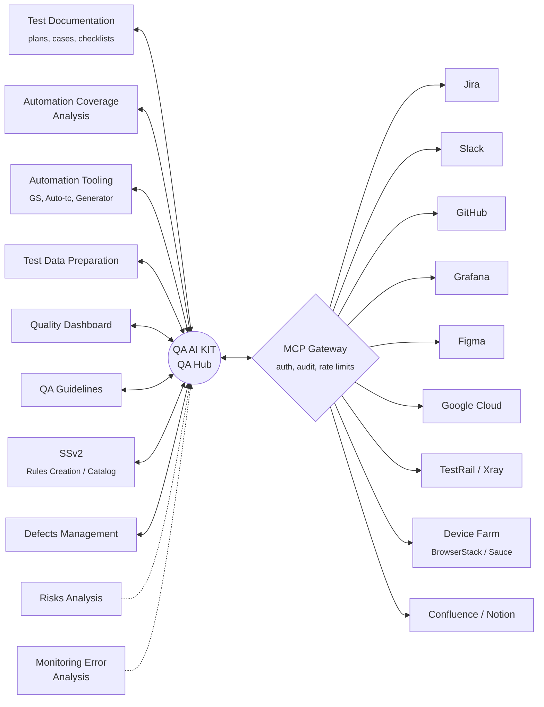

# QA AI KIT — Architecture

**QA AI KIT** is the central hub QAs interact with for all quality work. Around it sit modular **capabilities** (each a skill, MCP tool, or both). A single **MCP Gateway** is the integration layer to every external system — Jira, Slack, GitHub, Grafana, Figma, Google Cloud, TestRail, device farms, and so on. Capabilities never talk to external tools directly; they go through the Gateway. That way auth, rate limits, retries, and audit logging live in one place — not duplicated across every capability.

## Diagram

## Capabilities

### Active

| Capability | Shape | Purpose |
|---|---|---|
| **Test Documentation** | Skills | Plans, test cases, checklists. Includes `review-test-plan` ✅ (built), `generate-test-cases` (planned), `write-checklist` (planned). |
| **Automation Coverage Analysis** | Skill + MCP | What's tested vs not — reads test inventories via MCP Gateway. |
| **Automation Tooling** | Skill + MCP | GS, Auto-tc, Automation Generator. Generates / edits automation code. |
| **Test Data Preparation** | MCP | Seed test accounts, fixture data, sandbox state. |
| **Quality Dashboard** | MCP | Aggregated health metrics — pulls from Grafana, CI, Jira. |
| **QA Guidelines** | Skill | Standards and patterns the team follows. Reference content. |
| **SSv2** | MCP | Rules Creation / Edit & Rules Catalog. |
| **Defects Management** | Skill + MCP | Bug lifecycle, severity, triage — files / queries Jira via Gateway. |

### Planned

| Capability | Notes |
|---|---|
| **Risks Analysis** | Risk register + prioritization, per-feature risk scoring. |
| **Monitoring Error Analysis** | Pulls error patterns from Grafana / Sentry, surfaces regressions QA should look at. |

## MCP Gateway

Single integration layer. Every capability that needs an external system calls the Gateway, never the system directly. Responsibilities:

- **Auth** — one place for tokens / SSO / service accounts.
- **Audit logging** — every external call is logged with who/when/why.
- **Rate limiting** — protects external systems from runaway capabilities.
- **Retries / fallbacks** — uniform behavior across capabilities.
- **Schema normalization** — capabilities see one shape; Gateway translates to each integration's API.

### Integrations behind the Gateway

| Integration | Primary consumers |
|---|---|
| Jira | Defects Management |
| Slack | Quality Dashboard, Defects Management notifications |
| GitHub | Automation Tooling, Automation Coverage Analysis |
| Grafana | Monitoring Error Analysis, Quality Dashboard |
| Figma | Test Documentation (specs) |
| Google Cloud | Test Data Preparation, Quality Dashboard data sources |
| TestRail / Xray | Test Documentation, Automation Coverage Analysis |
| Device Farm (BrowserStack / Sauce) | Test Data Preparation, Test Documentation |
| Confluence / Notion | QA Guidelines, Test Documentation |

## Build order

1. **Skills first** for pure prompt/reasoning capabilities (Test Documentation, QA Guidelines).
2. **MCP Gateway scaffold** — even minimal — so the first integrating capability has somewhere to call.
3. **First integration through the Gateway**: Jira (highest-leverage — unblocks Defects Management).
4. **Roll out integrations** in the order capabilities need them, not all at once.
